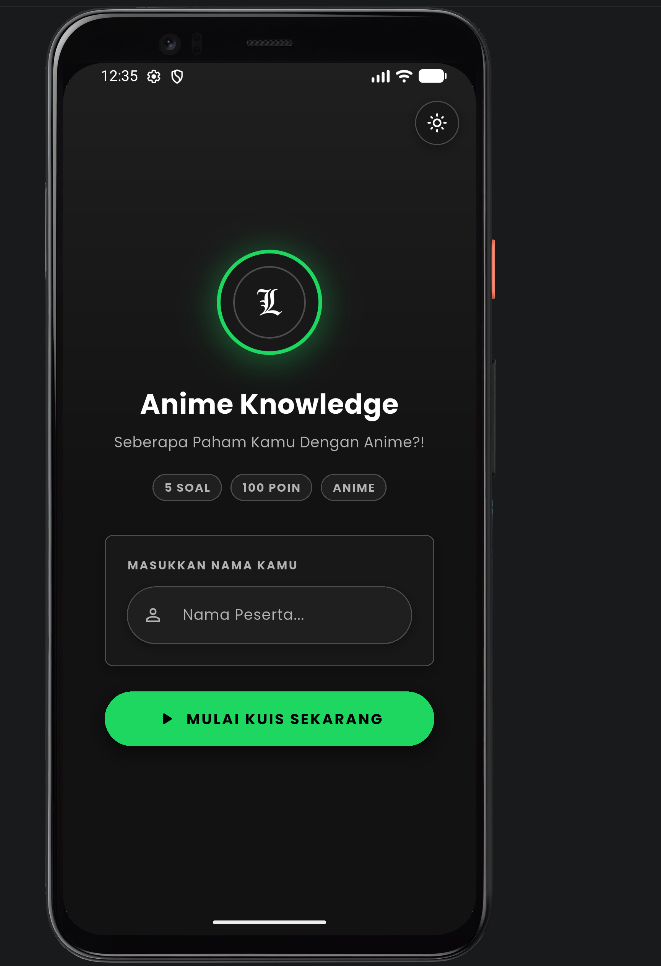
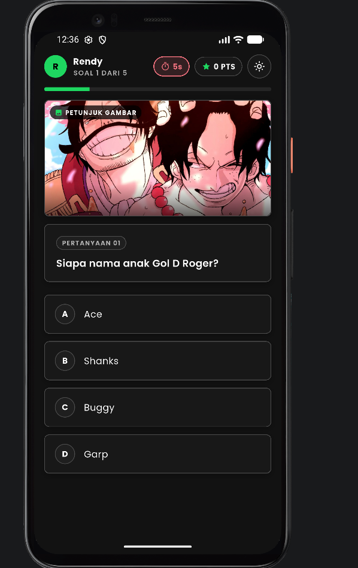
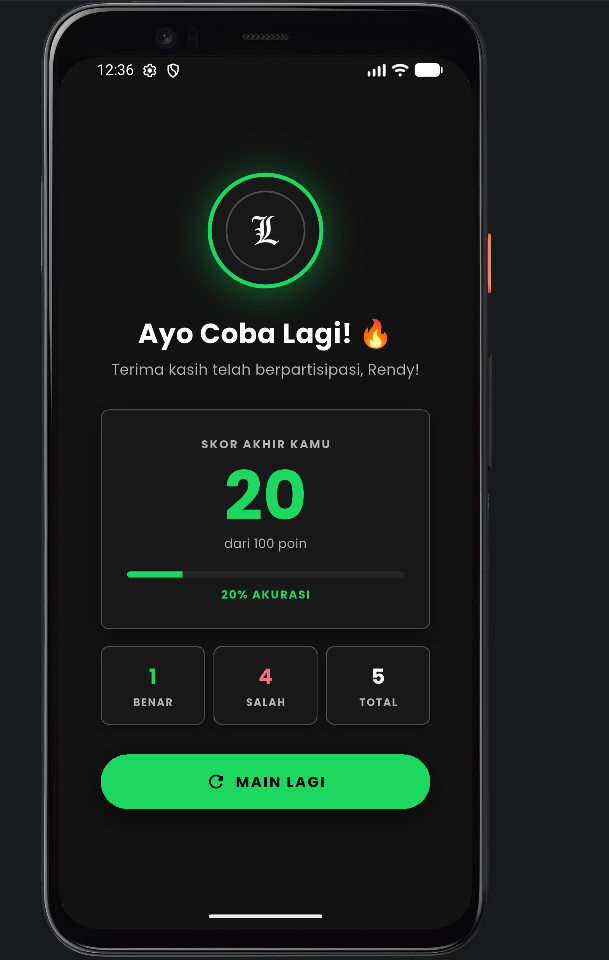

# QuizMate – Aplikasi Kuis Pilihan Ganda

---

## 👤 Identitas Mahasiswa

| | |
|---|---|
| **Nama** | Rendy Januarta |
| **NIM** | 241401090 |
| **Lab** | LAB 6 Pemrograman Mobile |

---

## 📱 Informasi Aplikasi

### Nama Aplikasi
**QuizMate** – Kuis Pilihan Ganda

### Deskripsi Singkat
QuizMate (Anime Knowledge Quiz) adalah aplikasi kuis pilihan ganda berbasis Flutter yang dirancang untuk menguji wawasan pengguna mengenai anime. Aplikasi ini dilengkapi dengan indikator *countdown timer* per soal (15 detik), petunjuk gambar (*visual clue*), feedback jawaban reaktif, serta statistik hasil kuis dan tingkat akurasi. Aplikasi mendukung tampilan responsif di berbagai ukuran layar (mobile, tablet, dan web/desktop), mengusung bahasa desain *Spotify Design System*, dan mendukung *Dark Mode* & *Light Mode*.

### Fitur-Fitur yang Tersedia

#### Fitur Wajib
- **Input Identitas Peserta** — Pengguna mengisi nama lengkap sebelum memulai kuis
- **Kuis Pilihan Ganda** — Setiap sesi kuis memiliki 5 soal pilihan ganda (A–D) bertema anime
- **Timer per Soal** — Setiap soal diberi waktu 15 detik; jika habis, otomatis ditandai dan memperingatkan peserta
- **Petunjuk Gambar (*Visual Clue*)** — Setiap soal dilengkapi petunjuk visual gambar
- **Feedback Jawaban** — Jawaban benar/salah ditampilkan secara visual setelah memilih opsi
- **Hasil Akhir** — Menampilkan skor, persentase akurasi, jumlah benar/salah, dan informasi peserta

#### Fitur Tambahan
- **Branding Logo Gotik "L"** — Elemen visual khas ikon Gotik "L" (Death Note) dengan *badge frame* kustom di halaman awal dan hasil kuis
- **Dark Mode & Light Mode** — Toggle beralih tema terang/gelap tersedia di semua halaman via tombol di header
- **Spotify Design System** — Penggunaan palet warna *Spotify Green* (`#1ED760`), latar *Near Black* (`#121212`), geometri *Full Pill*, dan tombol bergaya *system label uppercase*
- **Responsif Multi-Platform** — Layout adaptif untuk smartphone, tablet, dan web/desktop menggunakan `ResponsiveUtil`
- **Animasi Transisi** — Setiap perpindahan halaman dan perubahan state menggunakan animasi halus

---

## 📂 Struktur Proyek

```
lib/
├── models/
│   └── question_model.dart     # Model data soal, opsi jawaban, & path gambar
├── providers/
│   ├── quiz_provider.dart      # State management kuis, skor, & countdown timer (15s)
│   ├── theme_provider.dart     # State management tema (Dark / Light mode)
│   └── user_provider.dart      # State management nama peserta
├── screens/
│   ├── start_screen.dart       # Halaman awal (input nama & tombol mulai)
│   ├── quiz_screen.dart        # Halaman kuis, timer, petunjuk gambar & opsi jawaban
│   └── result_screen.dart      # Halaman hasil kuis, statistik akurasi, & skor
├── theme/
│   └── app_theme.dart          # Kumpulan tema & palet warna Spotify Design System
├── utils/
│   └── responsive_util.dart    # Helper responsivitas layar (mobile, tablet, desktop)
├── widgets/
│   ├── custom_button.dart      # Tombol reusable (Spotify Full Pill Button)
│   ├── custom_text_field.dart  # Field input nama peserta dengan animasi fokus
│   ├── gothic_l_badge.dart     # Badge frame logo Gotik "L"
│   └── option_card.dart        # Kartu pilihan jawaban kuis (A-D)
└── main.dart                   # Entry point aplikasi & MultiProvider setup
```

---

## 🚀 Cara Menjalankan Aplikasi

### Prasyarat
- Flutter SDK `^3.0.0`
- Dart SDK yang sesuai
- Emulator Android / iOS, browser Chrome, atau Windows desktop

### Langkah

```bash
# 1. Clone repository
git clone https://github.com/rendyjanuarta/uts_rendy.git
cd uts_rendy

# 2. Install dependencies
flutter pub get

# 3. Jalankan di emulator mobile
flutter run

# 4. Jalankan di browser (web)
flutter run -d chrome

# 5. Jalankan di Windows desktop
flutter run -d windows
```

---

## 🖼️ Screenshot Aplikasi

### Halaman Awal (Start Screen)


### Halaman Kuis (Quiz Screen)


### Halaman Hasil Kuis (Result Screen)


---

## 🎨 Dokumentasi

### Credit Aset
| Aset | Sumber |
|---|---|
| Ikon & Logo Gotik "L" (`l_logo.png`) | Logo Gotik "L" (Death Note) |
| Font **Poppins** | [Google Fonts](https://fonts.google.com/specimen/Poppins) – SIL Open Font License |
| Ikon Material | [Material Symbols](https://fonts.google.com/icons) – Apache License 2.0 |
| Framework & Library | [Flutter](https://flutter.dev) & [Provider](https://pub.dev/packages/provider) |

### Link Mockup / Prototype
> [LINK CANVA PROTOTYPE APLIKASI](https://canva.link/1bx8rs9qvn61rwe)

### Link Video Presentasi
> [LINK GDRIVE VIDEO PRESENTASI](https://drive.google.com/drive/folders/1-T_X72YFjfD37N_KyU8T_zlE2zNFzAuN?usp=sharing)

---

## 🔄 Alur Kerja Aplikasi

```
Halaman Awal (Start Screen)
    ├── Isi Nama Peserta
    ├── Pilih Tema (Dark / Light Mode)
    └── Tap "Mulai Kuis Sekarang"
            └──► Halaman Kuis (Quiz Screen)
                    ├── Countdown Timer 15 Detik per Soal
                    ├── Petunjuk Gambar Visual
                    ├── Pilih Jawaban (A, B, C, D) ──► Feedback Langsung
                    └── Tap "Lanjut Soal Berikutnya"
                            └──► Halaman Hasil (Result Screen)
                                    ├── Lihat Total Skor & Persentase Akurasi
                                    └── Tap "Main Lagi" ──► Kembali ke Halaman Awal
```

---

## 🧰 Teknologi yang Digunakan

| Teknologi | Keterangan |
|---|---|
| **Flutter** | Framework UI cross-platform |
| **Dart** | Bahasa pemrograman |
| **Provider** | State management untuk kuis, pengguna, dan tema |
| **Spotify Design System** | Bahasa desain UI (Spotify Green `#1ED760` & Near Black `#121212`) |
| **MediaQuery / ResponsiveUtil** | Deteksi ukuran layar untuk responsivitas adaptif |

---

*UTS Pemrograman Mobile – LAB 6 Pemrograman Mobile – Fasilkom-TI USU – 2026*
